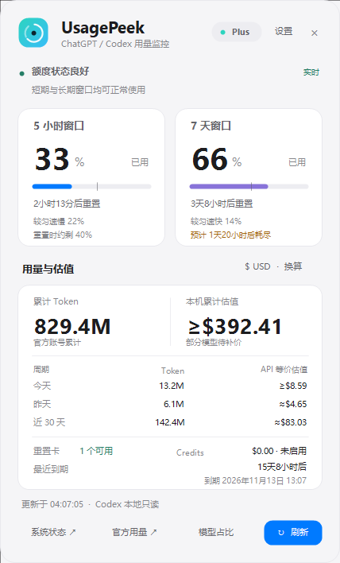
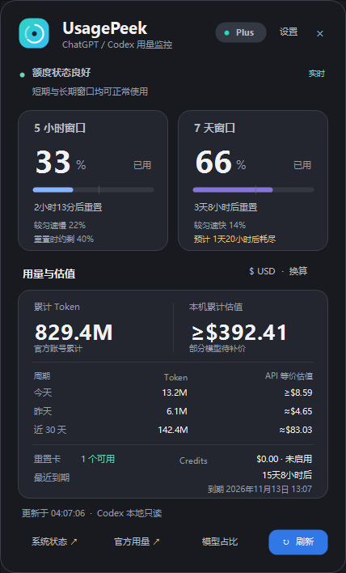
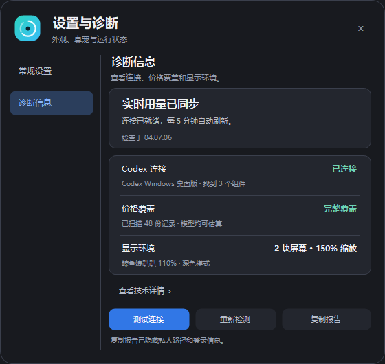

# UsagePeek

如果您喜欢，请点个star！

一个轻量的 Windows 系统托盘用量查看器，当前专注于 ChatGPT 账号下的
Codex 用量。数据通过本机 Codex 提供的只读接口和本机会话元数据获取。

> **与 OpenUsage 的关系：** UsagePeek 是从
> [OpenUsage](https://github.com/robinebers/openusage) 的界面、用量统计、
> 节奏预测和 Provider 思路改造成的 Windows/C# 版本。它是独立的社区实现，
> 不是 OpenUsage 官方 Windows 客户端。原项目作者与 MIT 许可署名见
> [THIRD_PARTY_NOTICES.md](THIRD_PARTY_NOTICES.md)。

<p align="center">
  
  
  <br>
  
  <br>
  <sub>浅色、深色与诊断概览，使用示例数据。</sub>
  <br>
  
  
  
  
  
</p>

## 下载

推荐从 [GitHub Releases](https://github.com/Supaio/UsagePeek/releases/latest)
下载单文件版，也可以[直接下载最新版 UsagePeek.exe](https://github.com/Supaio/UsagePeek/releases/latest/download/UsagePeek.exe)。
无需安装；放在个人目录后直接运行。如果只检测到受保护的 Codex 桌面版，
点击“修复连接”即可获取官方 Codex CLI 运行组件。
Release 页面同时提供 SHA-256；“关于”页可复制当前 EXE 的哈希，诊断技术详情可查看完整值。

## 当前功能

- 5 小时 Session 与 7 天 Weekly 用量、剩余量和重置倒计时。
- 按当前消耗速度显示相对匀速的快慢，并预测额度耗尽时间或重置时余量。
- 可用 Rate Limit Reset 次数、最近一张重置额度的到期时间。
- 仅在确认检测到新的重置卡发放时显示托盘通知；首次读取只建立基线，
  卡被使用、过期、刷新失败或旧详情补回时不会误报。
- Credits / Extra Usage 余额。
- 今天、昨天、近 30 天的本机 Token 与 API 等价费用估算。
- 默认以美元显示费用；点击顶部 `$ USD` 会联网取得最新工作日 USD/CNY
  参考汇率并切换为人民币，再点一次切回美元。
- **本机累计估值**：首次读取现存 Codex 会话建立持久账本，此后只追加经过
  指纹核对的新用量；Codex 删除、迁移或恢复旧会话时，累计值不会倒退或重复。
- **累计 Token**：优先显示 Codex 官方返回的账号历史累计；若当前版本或
  账号不支持，则回退为这台电脑现存本地记录的累计值。
- **模型用量占比**：按本机持久账本统计每个模型的累计 Token、数量和百分比；
  可从主面板底部或托盘菜单打开。
- **双显示模式**：通过集中设置，可在“一页看完”的经典面板与
  五种桌宠外形之间切换；紧凑轮廓减少屏幕占用，桌宠支持拖动并
  记住位置，左键点击后在旁边打开
  完整用量详情。新安装默认使用桌宠模式。
- **桌宠自定义**：在“设置与诊断”中可切换鲸鱼娘趴趴、菲比啾比、ChatGPT 娘、
  Claude 娘与奶蛙，选择
  显示 `5h` / `7d` 的已用或剩余百分比，并使用 75% / 100% / 125% 快捷尺寸
  或 50%–200% 自定义缩放；外形、口径和大小都会在重启后保留。
- **ChatGPT 娘外形**：根据参考形象制作的透明背景 Q 版白发龙娘，保留龙角、
  淡紫色翅膀和盘绕龙尾；同样支持摸头、状态表情、恢复日期和图片平均色气泡。
- **桌面散步与忙碌注视**：切回桌面后，桌宠立即在当前显示器的可用区域内
  小步走动、停留和转向，并带动各自的局部关节；浏览器、编辑器等应用窗口
  处于前台时，桌宠停下并朝向鼠标，不再使用键鼠空闲倒计时。
  顶部用量气泡保持正向，不随角色翻转。
  拖动、摸头、打开菜单或面板时暂停散步，切换到经典模式或隐藏桌宠后停止
  动画计时。只读取前台窗口类型和鼠标位置，不读取窗口内容或调用摄像头。
- **连续 2D 角色动画**：以原始角色图片作为纹理，实时计算局部骨骼与网格变形，
  让头部、手脚、头发、裙摆、尾巴和翅膀按各自的节奏运动。五个角色均有呼吸、
  眨眼、走停过渡和摸头反应；鲸鱼娘趴着挪动、菲比啾比轻轻蹦跳、ChatGPT 娘摇尾
  与扇翼、Claude 娘轻步走动、奶蛙交替迈脚。按当前显示器选择 60–120 FPS 的
  渲染目标，UI 忙碌时合并旧帧；隐藏后停止动画，重用图像与绘图资源。
  行走时抬脚与触地平滑过渡，改善鞋子拉长、脚趾压扁和左右脚互相拉扯，
  并在自定义大小和不同屏幕缩放下保持一致。
- **新增 Claude 娘、奶蛙**：分别采用橙发抱书的 Q 版造型与黄色 3D 奶蛙造型，
  同样支持散步、朝向鼠标、摸头、状态表情及图片平均色气泡。
- **集中设置与诊断**：右键“设置与诊断…”可在一个窗口内统一调整显示模式、
  桌宠外形、气泡口径、缩放、桌宠置顶与开机自启。普通窗口默认不强制置顶，
  桌宠置顶也默认关闭，并可直接从右键菜单切换；切换后立即生效并自动保存。
  诊断页先显示连接、价格覆盖和屏幕缩放的检查结果；技术详情可展开查看完整
  脱敏报告。支持重新检测、测试连接和复制报告，离线时会提示下一步处理方式。
- **主题与现代选择器**：支持浅色、深色、跟随 Windows 应用颜色三种主题，
  默认跟随系统；切换立即生效并自动保存，已打开的界面和右键菜单同步更新。
  设置项使用圆角下拉菜单，桌宠大小可直接输入百分比或用加减按钮调整。
  从桌宠或托盘打开设置时会将窗口激活到前台，普通设置窗口不会持续置顶。
- 桌宠上方的数字气泡会随后台刷新同步更新；两列百分比下方以 `MM/dd HH:mm`
  显示对应额度的本地恢复日期和时间，时间未知时显示 `--/-- --:--`。
  气泡从当前桌宠图片提取平均色（排除透明区域并按透明度加权），自动生成
  原始平均色背景，按背景明暗自动选择深色或浅色文字；切换外形时配色同步切换，
  无需打开完整面板。
- **Petpet 摸头互动**：无需按键，在角色表面快速左右来回移动鼠标即可触发
  `RUA`；一只大手会从左上方摸头，角色随即明显压扁并弹回。气泡和底部提示
  文字不参与识别，
  不会影响点击查看详情或拖动位置。
- 桌宠拖到当前显示器边缘时会自动停住，完整形象不会被拖出可见区域；鼠标进入
  另一块显示器后仍可继续跨屏移动。
- 支持 Windows 多显示器 DPI 缩放；在不同缩放比例的显示器之间切换时，
  窗口、文字、按钮和自绘图形会同步调整大小。
- 一键打开 OpenAI 系统状态页和 ChatGPT Codex 官方用量面板。
- 启动缓存、后台刷新、托盘左键展开、右键刷新或退出。
- 已在后台运行时再次双击 EXE，会唤醒现有实例并打开用量详情，不再静默退出。
- 托盘菜单可开关“开机自启”；经典模式自启时只驻留托盘，桌宠模式则恢复
  上次保存的桌宠位置，不主动弹出详情面板。
- 托盘菜单支持联网检查更新，下载后先校验 SHA-256，再由独立更新进程
  备份、替换并重启程序；只有新版本完成启动确认后才清理备份，启动失败或
  超时会自动恢复旧 EXE，并在托盘提示已经回滚。
- 托盘菜单的“关于 UsagePeek”会显示版本信息与项目鸣谢：感谢 OpenUsage
  提供产品构思、用量展示与交互思路，鲸鱼娘形象鸣谢 **ZipZipPipe**。
- “关于 UsagePeek”可一键复制当前 EXE 的完整 SHA-256；脱敏
  诊断报告也包含完整 SHA-256，方便与 Release 附件核对。
- 如果只检测到受 Windows 保护的桌面版组件，离线界面会显示“修复连接”。
  用户确认后，程序从 OpenAI 官方地址获取 Windows Codex CLI 安装器，安装到
  当前用户目录并自动重试，不要求 Node.js、PATH 配置或管理员权限。

## 数据口径

### 官方账号数据

UsagePeek 通过 Codex app-server 调用：

- `account/rateLimits/read`：额度窗口、Credits、重置额度及到期时间。
- `account/usage/read`：账号累计 Token 和官方每日活动桶。

账号累计可能包含其他设备或不完全出现在本机日志里的后台用量，因此它与
本机累计不一定相同。官方接口不支持时，界面会自动显示本机记录口径。

### 本机用量与模型占比

UsagePeek 从 `CODEX_HOME`（默认 `%USERPROFILE%\.codex`）下的 `sessions` 与
`archived_sessions` 发现用量。扫描器只解析 `turn_context` 和 `token_count`
元数据，不读取或保存提示词、回复及工具输出。

统计按累计计数的增量计算，并以时间戳和各类累计 Token 组成稳定指纹；写入前
会与账本逐条核对，因此重复刷新、恢复旧日志以及复制到分叉或子代理会话中的
相同历史都只计一次。账本以原子替换方式保存并保留上一份备份；已经入账的
事件即使源日志后来被删除，今天、昨天、近 30 天、本机累计和模型占比仍可按
Windows 当前本地时区重新汇总。只存在于其他设备且从未被本机发现的记录不会
进入本机账本。

### 费用估算

费用前的 `≈` 表示它是按 OpenAI 公开 API 标准价格计算的等价估算，**不是
ChatGPT 订阅账单，也不会从账号扣款**。估算区分普通输入、缓存输入、缓存
写入、输出及长上下文价格（[OpenAI 官方价格表](https://developers.openai.com/api/docs/pricing)，
基准：2026-10-01）。当前已覆盖 GPT-6 Astra / 6.1 Sol / Sol / Luna、GPT-5.6、
GPT-5.5 及常见历史 Codex 模型；`gpt-reserve` 按 Luna、`codex-auto-review` 按
Sol 的公开等价价格估算。若记录混有未知价格的模型，已识别部分仍会以 `≥` 显示
金额下限，并在模型占比页标记“价格待补充”；不会猜测未知部分的金额。

人民币金额同样只是显示换算。汇率由 Frankfurter 的免密钥 HTTPS 接口提供，
按最新工作日参考数据更新，不是盘中交易报价；切换到 CNY 时才发出请求，
请求内容只有固定的 USD/CNY 货币对，不包含账号或用量数据。

## 隐私与凭据

- 复用已登录的 Codex，本程序不读取、复制或保存 `auth.json` 中的令牌。
- 不发送遥测，不上传本机会话数据。
- “复制诊断”只包含版本、组件探测来源、刷新状态和价格覆盖情况；用户目录会被
  替换为环境变量占位符，其他绝对路径只保留盘符与文件名，原始异常也不会复制。
- 重置卡通知只在本地保存可用数量和发放/观察时间，用于去重。
- “修复连接”仅下载并运行 `https://chatgpt.com/codex/install.ps1` 官方安装器；
  UsagePeek 本身仍不打开、复制或输出登录令牌。
- `%LOCALAPPDATA%\UsagePeek\cache.json` 只保存聚合后的套餐、百分比、时间、
  模型名、Token 和估算金额；`usage-ledger.json` 及其 `.bak` 备份只保存去重
  指纹、事件时间、模型名、各类 Token 数和当次估值。它们都不包含账号 ID、
  Cookie、访问令牌或对话正文。

> 当前显示的是 ChatGPT 登录下的 **Codex 使用额度与 Token 活动**，不是普通
> ChatGPT 对话消息数。个人 ChatGPT Windows 客户端没有稳定、公开的通用
> 消息用量 API。

## 运行要求

- Windows 10 或 Windows 11
- .NET Framework 4.x
- 已登录的 Codex 桌面版、CLI 或 IDE 扩展；若缺少可运行 CLI，可在 UsagePeek
  中点击“修复连接”完成当前用户级安装

新版 Codex 可提供官方累计 Token 和重置额度详情；旧版仍可显示额度窗口，
并自动使用本机会话记录补足 Token 统计。

### 为什么打开桌面版仍可能显示离线

UsagePeek 需要自己启动一个只读的 `codex app-server`。Windows 商店安装的
Codex/ChatGPT 桌面版可能把内置 `codex.exe` 放在受保护的 WindowsApps 包中；
桌面应用自己能启动它，不代表普通第三方程序也有权限。因此只打开 Chappy、
Codex 或 ChatGPT 窗口并不能保证连接成功。

新版会自动查找以下来源：

1. `USAGEPEEK_CODEX_PATH` 指定的位置；
2. 官方独立安装目录和系统 `PATH`；
3. VS Code、VS Code Insiders、Cursor 的 `openai.chatgpt` 扩展；
4. Codex Windows 桌面包；
5. npm、pnpm、Scoop 的常见命令位置。

如果界面提示桌面组件受 Windows 保护，请另行安装官方 Codex CLI，在 Windows
终端运行一次 `codex` 并选择 ChatGPT 登录，然后重新刷新；也可以直接点击新版
界面底部的“修复连接”，由 UsagePeek 调用 OpenAI 官方安装器并自动重试。
若 Codex 配置为在 WSL 中运行，WSL 默认使用另一份 `~/.codex`；需要让 WSL
与 Windows 共用 `CODEX_HOME`，或在 Windows 原生 CLI 中单独登录一次。

## 构建与运行

```powershell
cd usagepeek
.\build.cmd
.\bin\UsagePeek.exe
```

程序启动后会出现在系统托盘。经典模式下，左键单击托盘图标可显示或隐藏面板；
桌宠模式下，单击桌宠或托盘图标会在桌宠旁打开详情。右键托盘、面板或桌宠均可
打开“设置与诊断…”，也可在详情面板顶部点击“设置”。显示模式、外形、用量
口径、大小与开机自启统一在设置页管理；诊断页可测试连接和复制安全信息。如果
Codex 不在自动探测的位置，可将完整路径放入
`USAGEPEEK_CODEX_PATH`，支持 `codex.exe` 或 `codex.cmd`。

给其他人测试时，技术上只需要发送 `UsagePeek.exe`。建议让对方把它放在桌面或
个人文件夹后运行；如果出现桌面组件受保护提示，点击“修复连接”即可。首次修复
需要联网，并会明确询问确认，不会静默安装。

## 联网更新

公开版本默认从 `Supaio/UsagePeek` 的 `update.json` 检查更新；下载完成后会
核对 SHA-256，并在用户确认后原地替换。也可以通过环境变量
`USAGEPEEK_UPDATE_URL`，或以下文件覆盖默认清单地址：

```text
%LOCALAPPDATA%\UsagePeek\update-url.txt
```

清单格式见 `update-manifest.example.json`：

```json
{
  "version": "2.0.1",
  "url": "https://example.com/releases/UsagePeek.exe",
  "sha256": "64 位十六进制 SHA-256",
  "notes": "更新说明"
}
```

发布新版本时，先构建 `dist\UsagePeek.exe`，再计算最终文件的 SHA-256：

```powershell
(Get-FileHash .\dist\UsagePeek.exe -Algorithm SHA256).Hash
```

把该值写入 `update.json`。Release 工作流会拒绝版本或哈希不一致的 EXE，并
额外发布 `SHA256SUMS.txt`。

配置后，
程序每次启动会静默检查一次，也可从托盘菜单手动检查；发现新版本后仍会先询问，
不会静默安装。当前程序所在目录必须可写，建议放在个人目录而不是 Program Files。

## 验证

解析与本地增量/去重测试：

```powershell
.\tests\run.ps1
```

渲染预览：

```powershell
.\tests\render.ps1
```

已登录机器上的端到端只读检查：

```powershell
.\tests\run-live.ps1
```

联网汇率检查：

```powershell
.\tests\run-exchange-live.ps1
```

官方 CLI 安装源检查（只下载并校验脚本，不执行安装）：

```powershell
.\tests\run-bootstrap-source-live.ps1
```

## 设计取舍

项目从 OpenUsage 的托盘交互、节奏预测、Provider 抽象和本地用量聚合思路
改造而来，并针对 Windows 原生环境重新实现。当前没有加入多账号、遥测、
本地 HTTP API 或重置额度消费操作；重置额度只查看、不使用，避免不可逆操作。

数据获取层继续实现 `IUsageProvider`，未来可增加自部署 DeepSeek Provider，
无需重写托盘和主界面。Codex app-server 是随本地工具演进的接口；实时读取
失败时，UsagePeek 会保留最近成功数据并明确标为缓存。
